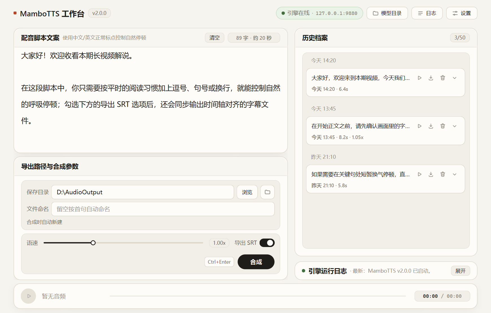

<div align="center">


<h1>MamboTTS</h1>

<p>Local Windows AI voiceover &amp; subtitle studio built for long-form narration and storytelling</p>

<p>
  
  
  
  <a href="LICENSE"></a>
</p>

<p>
  <a href="README.md"></a>
  
</p>

<p>
  <a href="#screenshots">Screenshots</a> &bull;
  <a href="#features">Features</a> &bull;
  <a href="#quick-start">Quick Start</a> &bull;
  <a href="#cli-usage">CLI</a> &bull;
  <a href="#faq">FAQ</a>
</p>

</div>

Desktop voice synthesis workstation and headless CLI powered by `GPT-SoVITS v5`. Ships with a ready-to-use default voice preset and bundled portable runtime — generate offline speech and time-aligned `.srt` subtitles directly on your NVIDIA GPU without manual Python setup.

## Screenshots

**Main Studio Workspace**

<p align="center">
  
</p>

**First-Run Engine Setup Wizard**

<p align="center">
  
</p>

## Features

- **Natural punctuation phrasing**: Control pauses and breathing with standard punctuation and line breaks — no inline markup tags needed. Long or unpunctuated scripts are split automatically.
- **Audio + `.srt` subtitle export**: Export timeline-aligned `.srt` subtitles alongside WAV output, with built-in silence trimming and loudness normalization ready for video editing.
- **Built-in audition & history**: Continuously adjustable playback speed (`0.10x – 3.00x`), seekable preview bar, and automatic archival of the 50 most recent generations for replay or export.
- **Guided offline engine setup**: Automatically detects NVIDIA RTX 50-series or general CUDA GPUs, benchmarks multiple download mirrors, verifies checksums, and supports resumable downloads. Once installed, daily synthesis runs completely offline.
- **Headless CLI automation**: `synth`, `batch`, and `engine` subcommands make it straightforward to script long-form batch jobs with per-clause WAV slices and `manifest.json` output.

## Quick Start

> [!NOTE]
> Extract or clone to a **short ASCII-only path without spaces** (for example `D:\MamboTTS\`). Non-ASCII or Desktop paths may cause compatibility issues in the external inference engine or archive extractor.

### Portable Release (Recommended)

1. Download the latest portable archive from Releases and extract it (includes the embedded Python runtime and default voice preset).
2. Double-click **`MamboTTS.bat`**. On first launch, follow the setup wizard to download and install the ~`10 GiB` `GPT-SoVITS v5` engine package (supports resuming interrupted downloads).
3. Once the status pill shows **Engine Online** (`引擎在线`), enter your script and press `Ctrl + Enter` to synthesize.

> Shortcuts: `Ctrl + Enter` Synthesize &middot; `Space` Play / Pause preview &middot; `Esc` Cancel active job &middot; Double-click speed slider to reset `1.00x`

### Running from Source / Custom Reference Voice

1. Install **Python 3.10+** (check `Add Python to PATH`).
2. Place the voice preset files into `models/` (if replacing `refer.wav`, keep `refer.txt` updated to match the spoken reference transcript):

| File | Required | Description |
| --- | --- | --- |
| `manbo-e10.ckpt` | Yes | GPT semantic checkpoint |
| `manbo_e8_s168.pth` | Yes | SoVITS acoustic weights |
| `refer.wav` | Yes | Default reference audio |
| `refer.txt` | Recommended | Transcript matching `refer.wav` |

3. Launch **`MamboTTS.bat`** to automatically create `.venv`, install `requirements.txt`, and start the app.
4. Run the unit test suite:

```bat
.\.venv\Scripts\python.exe -m unittest discover -s tests -v
```

## System Requirements

| Component | Requirement |
| --- | --- |
| OS | Windows 10 / 11 (64-bit) |
| GPU | NVIDIA GPU (≥ 6 GB VRAM recommended; supports RTX 50-series and general CUDA builds) |
| Disk Space | 36–40 GiB free space recommended for engine download & extraction |
| Network | Required for first-time engine setup only; synthesis runs 100% offline |

## CLI Usage

Running `python -m mambotts` without subcommands launches the GUI; passing a subcommand runs headless CLI mode (use `runtime\python.exe` in portable builds):

```bat
:: Synthesize text and export synchronized .srt subtitles
python -m mambotts synth "Hello! Let's narrate a story today." -o out.wav --srt --speed 1.1

:: Batch process a UTF-8 script into merged WAV, sliced clause WAVs, and manifest.json
python -m mambotts batch script.txt --out-dir .\out --srt

:: Inspect, start/stop background daemon, or install the local engine
python -m mambotts engine status --json
python -m mambotts engine start
python -m mambotts engine stop
python -m mambotts engine install --gpu auto
```

- **Common options** (`synth` / `batch`): `--speed`, `--srt`, `--no-trim`, `--no-normalize`, `--no-cache`, `--api-url`, `--auto-start-engine`, `--json`
- **`batch` options**: `--out-dir <dir>`, `--manifest [path]` (defaults to `<out-dir>\manifest.json`)
- **`engine install`**: `--gpu {auto,nvidia50,general}` (`auto` detects GPU architecture)
- **Exit codes**: `0` Success · `1` Runtime error · `2` Invalid arguments · `3` Engine offline

## FAQ

**Q: What if built-in mirrors are slow or unreachable?**  
Click **Copy Link** (`复制链接`) in the setup wizard, download the `.7z` archive manually via your browser or download manager into `engine_temp/`, then click **Start Download & Install** (`开始下载并安装`) to verify and extract offline. You can also add custom `{file}` URL templates in `mirrors.txt`.

**Q: How do I troubleshoot `Response ended prematurely` or aborted jobs?**  
This usually happens when an input segment exceeds model limits or the GPU runs out of VRAM (CUDA OOM). Click **Log File** (`日志文件`) in the studio log strip to inspect `engine.log`, break long sentences with punctuation, or restart the engine.

**Q: How do I connect a self-hosted engine or stop a leftover process on port 9880?**  
Open **Settings** (`设置`) in the top-right bar to customize the engine API URL (`api_url` in `config.json`, default `http://127.0.0.1:9880`). Closing the GUI automatically stops its managed engine; background instances started via `engine start` can be stopped with `python -m mambotts engine stop`.

**Q: What changed from v1.x?**  
v2 is a ground-up rewrite unifying the interface around the light studio workspace and adding a full headless CLI. It focuses on a single default voice preset with natural punctuation phrasing, removing the legacy dark theme and inline expression tags while keeping the [Premiere-Pro-UXP/](Premiere-Pro-UXP/README.md) plugin directory.

## Acknowledgements & License

- Speech synthesis is powered by [RVC-Boss/GPT-SoVITS](https://github.com/RVC-Boss/GPT-SoVITS), subject to upstream licenses.
- Thanks to [@2710165659](https://github.com/2710165659) for contributing Premiere Pro UXP plugin support.
- MamboTTS code is released under the [MIT License](LICENSE). Intended for personal learning, research, and lawful content creation only — users are responsible for ensuring proper rights to reference audio and generated outputs.
