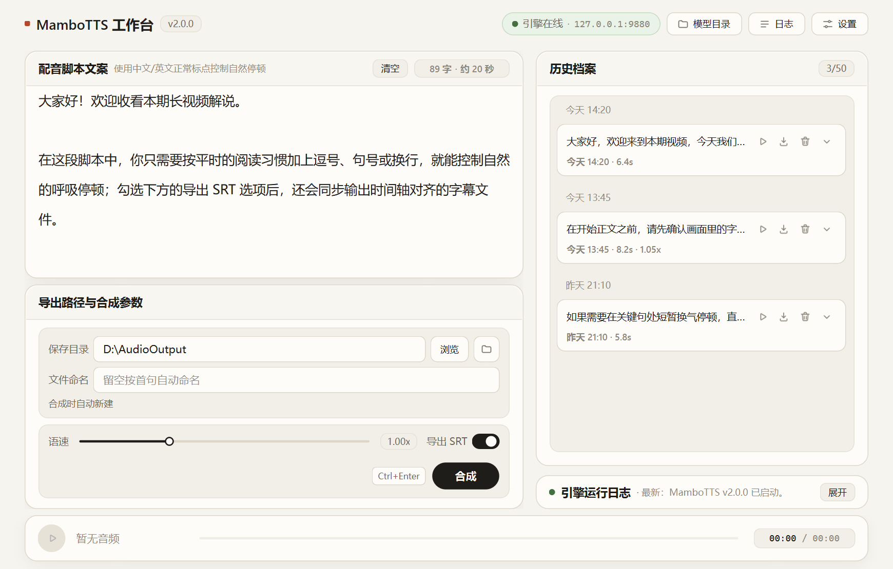
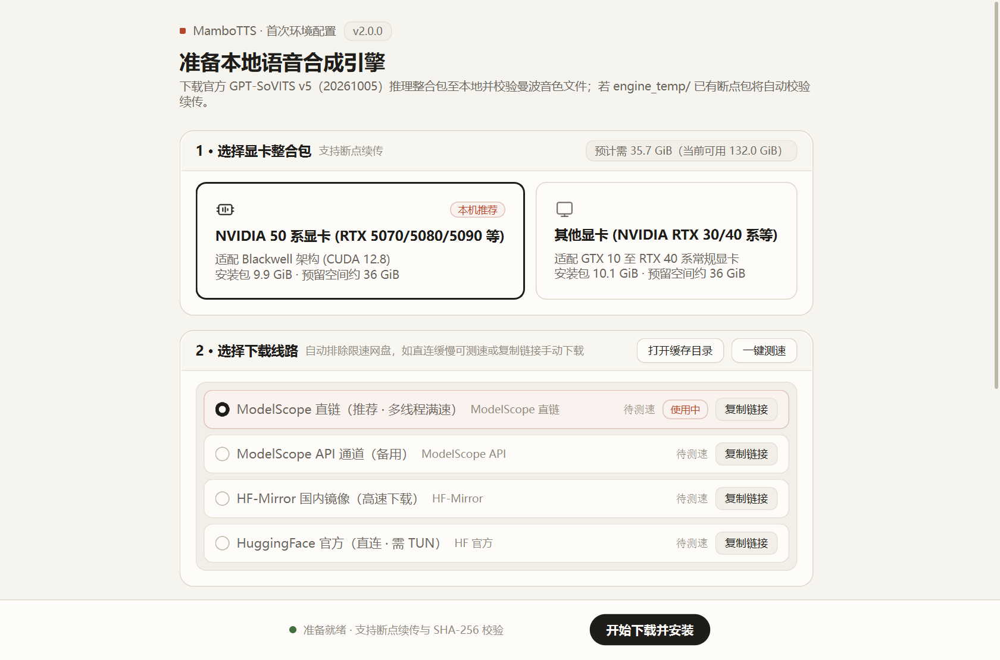

<div align="center">


<h1>MamboTTS</h1>

<p>本地运行的 AI 配音与字幕导出工具，专为视频旁白与剧情解说设计</p>

<p>
  
  
  
  <a href="LICENSE"></a>
</p>

<p>
  
  <a href="README.en.md"></a>
</p>

<p>
  <a href="#界面预览">界面预览</a> &bull;
  <a href="#功能特点">功能特点</a> &bull;
  <a href="#快速开始">快速开始</a> &bull;
  <a href="#命令行用法">命令行</a> &bull;
  <a href="#常见问题">常见问题</a>
</p>

</div>

基于 `GPT-SoVITS v5` 的桌面配音工作台与命令行工具。预设默认配音音色，无需配置 Python 环境，在本地 NVIDIA 显卡即可离线合成语音并同步生成 `.srt` 字幕。

## 界面预览

**主工作台**

<p align="center">
  
</p>

**首次环境安装向导**

<p align="center">
  
</p>

## 功能特点

- **自然断句，告别标签**：直接使用中文/英文常规标点与换行控制换气停顿，长段或无标点文稿自动分段合成。
- **配音字幕同步导出**：支持同步生成时间轴对齐的 `.srt` 字幕，自带静音修剪与响度均衡，导出即可导入剪辑。
- **工作台即时试听**：支持 `0.10x – 3.00x` 连续调速、进度条拖拽试听，并自动保留最近 50 条历史归档以便回放与另存。
- **一键部署引擎**：自动识别 RTX 50 系或通用 NVIDIA 显卡并匹配整合包，内置多源测速与断点续传，日常推理完全离线。
- **支持脚本批处理**：提供 `synth` / `batch` / `engine` 无头命令行接口，适合自动化流水线与批量切分导出清单。

## 快速开始

> [!NOTE]
> 请解压或克隆至**全英文且不含空格的路径**（如 `D:\MamboTTS\`），避免中文或桌面路径引发外部引擎及解压异常。

### 绿色便携版（推荐）

1. 前往 Releases 下载最新绿色便携压缩包并解压（已内置运行环境与默认音色）。
2. 双击 **`MamboTTS.bat`**，首次运行按向导提示下载约 `10 GiB` 引擎整合包并自动安装（支持中断续传）。
3. 右上角显示「引擎在线」后输入文案，按 `Ctrl + Enter` 即可开始合成。

> 常用操作：`Ctrl + Enter` 开始合成 &middot; `Space` 播放/暂停试听 &middot; `Esc` 中止合成 &middot; 双击语速滑块恢复 `1.00x`

### 从源码运行 / 替换默认音色

1. 确保本机已安装 **Python 3.10+**（安装时勾选 `Add Python to PATH`）。
2. 准备音色文件放入根目录 `models/`（若替换 `refer.wav`，请同步更新对应台词文本 `refer.txt`）：

| 文件名 | 必需 | 说明 |
| --- | --- | --- |
| `manbo-e10.ckpt` | 是 | GPT 语义权重 |
| `manbo_e8_s168.pth` | 是 | SoVITS 声学权重 |
| `refer.wav` | 是 | 默认参考音频 |
| `refer.txt` | 建议 | 参考音频对应台词 |

3. 双击 **`MamboTTS.bat`**，脚本将自动创建 `.venv`、安装 `requirements.txt` 依赖并启动界面。
4. 运行单元测试：

```bat
.\.venv\Scripts\python.exe -m unittest discover -s tests -v
```

## 运行环境

| 项目 | 要求 |
| --- | --- |
| 操作系统 | Windows 10 / 11（64 位） |
| 显卡 | NVIDIA GPU（推荐显存 ≥ 6 GB；支持 RTX 50 系与通用 N 卡整合包） |
| 磁盘空间 | 建议预留 36–40 GiB（引擎下载与解压所需空间） |
| 网络 | 仅首次安装引擎需联网，日常合成完全离线 |

## 命令行用法

不带子命令执行 `python -m mambotts` 启动图形界面；指定子命令则进入无头 CLI 模式（便携版将 `python` 替换为 `runtime\python.exe`）：

```bat
:: 合成单段文案并导出 .srt 字幕
python -m mambotts synth "大家好！今天讲个故事。" -o out.wav --srt --speed 1.1

:: 批量处理 UTF-8 文本，导出总音频、分段音频与 manifest.json
python -m mambotts batch script.txt --out-dir .\out --srt

:: 引擎状态查询、后台启停与安装
python -m mambotts engine status --json
python -m mambotts engine start
python -m mambotts engine stop
python -m mambotts engine install --gpu auto
```

- **通用参数**（`synth` / `batch`）：`--speed`、`--srt`、`--no-trim`、`--no-normalize`、`--no-cache`、`--api-url`、`--auto-start-engine`、`--json`
- **`batch` 参数**：`--out-dir <目录>`、`--manifest [路径]`（默认写入 `<out-dir>\manifest.json`）
- **`engine install`**：`--gpu {auto,nvidia50,general}`（默认 `auto` 自动探测显卡）
- **退出码**：`0` 成功 · `1` 运行错误 · `2` 参数错误 · `3` 引擎离线

## 常见问题

**Q：整合包下载过慢或全部内置源失败怎么办？**  
在安装向导页点击「复制链接」，使用浏览器或下载工具下载 `.7z` 整合包后放入根目录 `engine_temp/`，重新点击「开始下载并安装」即可自动校验并跳过下载。如需自定义下载源，可在根目录 `mirrors.txt` 按 `{file}` 模板添加镜像地址。

**Q：合成中断或提示 `Response ended prematurely` 如何排查？**  
通常源于单句过长或显存不足（CUDA OOM）。可点击界面右下角「日志文件」打开 `engine.log` 查看详细报错，适当增加标点分段或重启引擎后重试。

**Q：如何连接自建引擎或清理占用的 9880 端口进程？**  
右上角「设置」中可修改引擎 API 地址（对应 `config.json` 的 `api_url`，默认 `http://127.0.0.1:9880`）。窗口关闭时会自动停止由其启动的引擎；通过 `engine start` 启动的后台进程可执行 `python -m mambotts engine stop` 清理。

**Q：与 v1.x 版本有哪些变化？**  
v2 为重构版本，统一为浅色桌面工作台并新增无头 CLI；专注默认单音色与自然标点断句，移除了深色主题与内联标签语法，并保留了 [Premiere-Pro-UXP/](Premiere-Pro-UXP/README.md) 编辑器插件。

## 致谢与协议

- 语音推理能力基于 [RVC-Boss/GPT-SoVITS](https://github.com/RVC-Boss/GPT-SoVITS)，遵循各自上游开源协议。
- 感谢 [@2710165659](https://github.com/2710165659) 贡献的 Premiere Pro UXP 插件支持。
- 本项目代码基于 [MIT License](LICENSE) 开源；仅供学习、研究与合法创作使用，请确保参考音频与生成内容的授权合规，严禁用于欺诈、冒充他人或其他违法用途。
